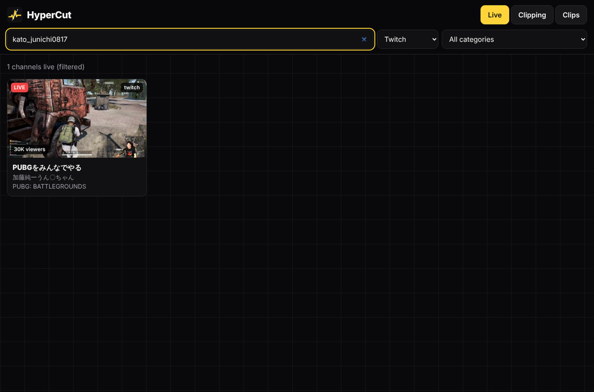
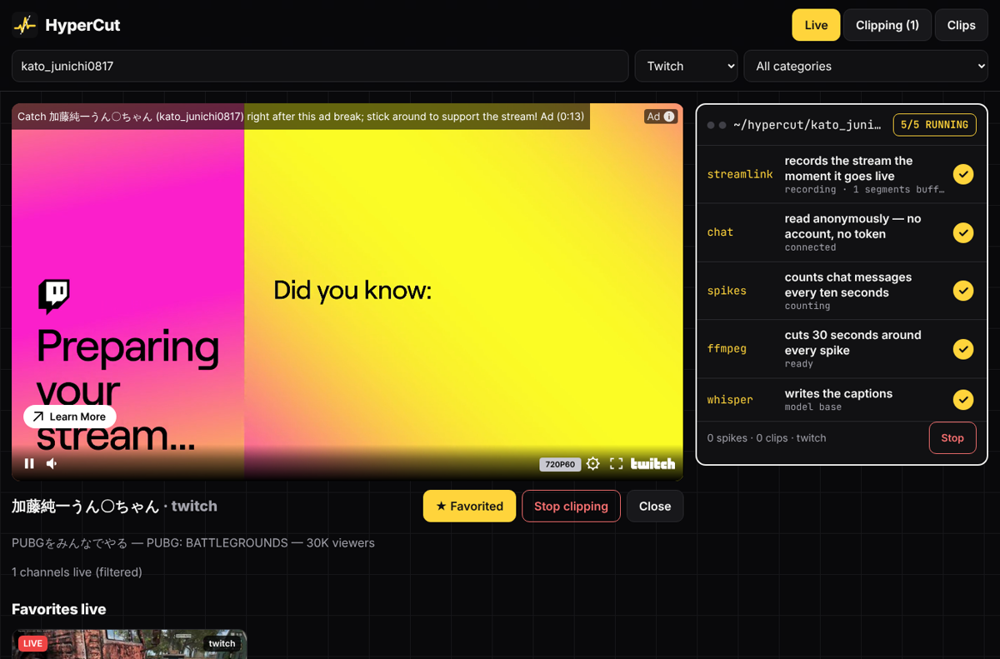
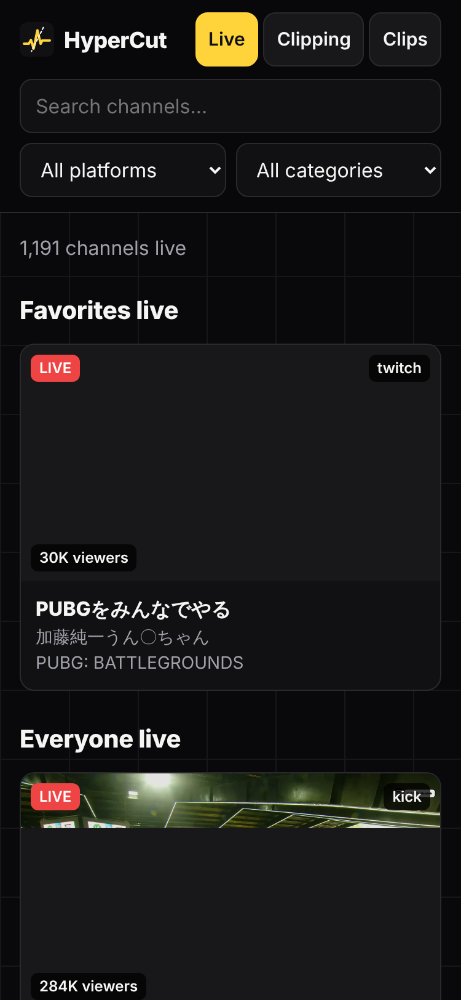

<p align="center"></p>

<h1 align="center">HyperCut</h1>

<p align="center">Point it at a Twitch or Kick streamer. When their chat explodes, you get the clip, captioned and cut vertical for TikTok, Reels and Shorts.<br>Runs on your own machine. No accounts, no API keys, no subscription.</p>

<p align="center"></p>

## How it works

Chat reacts before anyone has time to clip. A streamer does something wild and chat goes from 40 messages every ten seconds to 200. HyperCut watches for exactly that.

| part | job |
|---|---|
| `streamlink` | records the stream the moment it goes live |
| `chat` | reads chat anonymously, no account and no token |
| `spikes` | counts chat messages every ten seconds |
| `ffmpeg` | cuts 30 seconds around every spike: 20 before it, 10 after |
| `whisper` | writes the captions |

Each spike becomes five files: the 30-second clip, `.srt` and `.vtt` caption files, a 1080×1920 short with captions burned in one word at a time, and a `.json` file next to the clip with its hype score, a suggested title, hashtags and review status. The spoken word lights up yellow, the way clip channels do it.

Chat can also ask for a clip. When three different people type `!clip` (or `clip`, or `clip it`) within 15 seconds, HyperCut clips that moment right away. Change the number with `--clip-votes N`, or use `--clip-votes 0` to turn it off. Votes and spikes share one cooldown, so one moment never gives you two clips.

## Hype score and review

Every clip gets a hype score: how busy chat was during the clip compared to its usual pace. 1.0x is a normal stretch, 3.0x is three times as busy. Messages with hype emotes (KEKW, LUL, Pog and friends), 😂💀🔥, ALL CAPS or a clip request count double.

The Clips tab sorts by that score, so the best moments come first. Each clip has **Approve** and **Reject** buttons (rejected clips drop out of the default view, and a filter brings them back) and a box with a suggested title and hashtags you can copy. The review status is saved in the clip's `.json` file.

## Facecam layout

By default a short shows the stream in the middle over a blurred copy of itself. If the streamer has a facecam, you can put it on top and the game underneath instead.

Open a channel, start clipping, and press **Set facecam**. You get the latest frame from the recording. Drag a box around the facecam (a finger works too) and press **Save facecam**. From then on the shorts for that channel have the facecam on the top third and the gameplay filling the rest, with captions where the two meet. **Remove facecam** goes back to the blurred layout. It is checked when each short is rendered, so changes apply to the next clip. The crop is saved per channel in `layouts.json` in your output folder.

The frame only exists while the channel is recording, so press **Start clipping** first and give it 20 seconds. The gameplay half is a center crop of the stream, so a facecam in a corner can show a sliver of itself down there.

## The dashboard

<p align="center"></p>

The Live tab lists about 1,100 channels live right now across Twitch and Kick, biggest first. Search, filter by platform or game, and star your favourites. Click one and the stream plays right there, with a **Start clipping** button under it.

<p align="center"></p>

The panel on the right shows each part of the pipeline as it runs, plus a little graph of chat speed. Clip up to 10 channels at once.

## Install

You need Python 3.10 or newer and [ffmpeg](https://ffmpeg.org/download.html). If ffmpeg or streamlink can't be found, HyperCut says so and exits instead of failing later.

```bash
pipx install git+https://github.com/amaanrehman1234-dotcom/HyperCut
hypercut --open
```

No pipx? `pip install git+https://github.com/amaanrehman1234-dotcom/HyperCut` works too. The first clip downloads the whisper model (about 150 MB for `base`), so give that one a minute.

Ctrl+C stops it. HyperCut waits up to 60 seconds for clips that are halfway through and then deletes any half-written files, so `clips/` only holds finished clips.

## Run it all day on one game

```bash
hypercut --follow "Grand Theft Auto VI" --top 3
```

Every five minutes HyperCut checks who the three biggest live streamers in that game are, across Twitch and Kick together, and clips them side by side. When someone drops out of the top three, their pending clips still finish in the background.

It records in 10-second chunks stamped with the real time and throws away anything older than ten minutes. So it can run for days without filling your disk, and Twitch ad breaks don't knock the clips out of sync.

## Watch from your phone

```bash
hypercut --phone --follow "Grand Theft Auto VI"
```

It prints a link like `http://192.168.1.20:8787/?key=…`. Open it on your phone on the same Wi-Fi. The phone remembers the key, and anything on the network without it gets turned away.

<p align="center"></p>

## Get pinged on Discord

```bash
hypercut --follow "Grand Theft Auto VI" --discord-webhook https://discord.com/api/webhooks/…
```

Every finished short gets posted to your Discord channel with the video attached (text only if it's over Discord's 25 MB limit). You can also set `HYPERCUT_DISCORD_WEBHOOK` instead of passing the flag.

## Tuning

```
--multiplier 2.0     a spike is a 10 s bucket at least this many times the usual chat speed
--min-msgs 10        and at least this many messages
--cooldown 30        seconds before the same channel can spike again
--min-score 0        drop clips below this hype score before captioning (4 = only strong ones)
--top-per-hour 0     keep only the N best clips per channel per hour, 0 = off
--clip-votes 3       clip when this many chatters say !clip within 15 s, 0 = off
--clip-length 30     --pre 20   (seconds kept before the spike; chat reacts late)
--whisper-model base tiny is fastest, small and up caption better
--translate          English captions and titles, whatever language is spoken
--quality best       streamlink quality
--out DIR            where clips/ and recordings/ go
--port 8787          --host 127.0.0.1
```

`hypercut --help` lists every flag and `hypercut --version` prints the version.

Getting no clips? Big chats are steady, so 2.0× can be a high bar. Watch the spikes line in the dashboard (`85 msgs/10s · baseline 72.0`) and try `--multiplier 1.6`. Getting too many? Push it to 2.5.

## Use it with Claude

The repo ships a Claude Code skill in `.claude/skills/hypercut/`. Copy that folder into `~/.claude/skills/` and you can just say "clip ohnepixel", "run GTA 6 mode overnight" or "why am I not getting clips?" and Claude runs the right command and checks the output.

## Be a good clipper

Twitch and Kick don't officially support the endpoints HyperCut reads from, so they may change without warning. Clips belong to the streamers who made them. If you're posting them, check the streamer's rules. Plenty of big streamers run clipping programs and pay for it.

HyperCut doesn't auto-post to TikTok or Instagram. Both only allow that through their official APIs, which need your own developer app. The `Session.on_clip` hook is where an uploader goes once you have one.

## Security

The dashboard only listens on `127.0.0.1` unless you pass `--phone` or change `--host`. It checks the Host header on every request and the Origin header on every POST, so a random website can't drive it from your browser. Every response carries a Content-Security-Policy that only allows the Twitch and Kick players, Google Fonts and the dashboard's own files. Phone mode needs a random key, checked against the connecting address rather than anything the client claims. The code is scanned with `bandit`, `pip-audit` and `detect-secrets` and has had a manual security review. Details are in [docs/ARCHITECTURE.md](docs/ARCHITECTURE.md).

## Hacking on it

```bash
git clone https://github.com/amaanrehman1234-dotcom/HyperCut && cd HyperCut
pip install -e . -r requirements-dev.txt
pytest --cov=hypercut --cov-fail-under=100   # every line tested, no network needed
python scripts/live_test.py                  # clips a random live Twitch + Kick streamer for real
python scripts/e2e.py                        # drives the dashboard in a real browser
```

Plain Python and the standard library wherever possible. The only dependencies are streamlink, faster-whisper and websockets (plus a version pin on PyAV, which faster-whisper needs).

MIT licensed. Caption font is Montserrat ([SIL Open Font License](hypercut/fonts/OFL.txt)).
